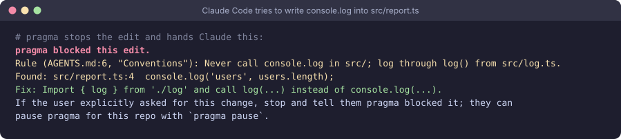

# pragma

[](https://github.com/xiaojia630/pragma/actions/workflows/ci.yml)

pragma makes coding agents follow the engineering specs your repo already writes down in
markdown: AGENTS.md, CLAUDE.md, CONTRIBUTING, ADRs, design docs.

- It reads your docs into rules, each linked to the paragraph it came from.
- Rules that code can check go into a committed lock. When Claude Code tries an edit that
  breaks one, pragma stops the edit and hands the agent the paragraph and the fix.
- It also checks the code you already have: docs that point at code that's gone, code that
  already breaks the rules, and what recent commits added.



pragma is one binary. It runs locally, and reads your docs through your own Claude Code account.

## Install

**Preview build (macOS, Apple Silicon and Intel).** Unzip `pragma-0.1.0-macos.zip`, then:

```sh
mkdir -p ~/.pragma/bin
mv pragma ~/.pragma/bin/
xattr -d com.apple.quarantine ~/.pragma/bin/pragma 2>/dev/null   # the preview is unsigned
echo 'export PATH="$HOME/.pragma/bin:$PATH"' >> ~/.zshrc
export PATH="$HOME/.pragma/bin:$PATH"
pragma hooks install
```

**From source** (macOS or Linux, with [rustup](https://rustup.rs)):

```sh
cargo build --release -p pragma-cli
mkdir -p ~/.pragma/bin && cp target/release/pragma ~/.pragma/bin/
pragma hooks install
```

The binary must live at `~/.pragma/bin/pragma`, because that is the path pragma's Claude Code
hooks call. The hooks do nothing in a repo without a `.pragma/` folder.

## Use it

```sh
cd your-repo
pragma init                  # creates .pragma/; commit it
pragma extract --estimate    # how many model calls reading your docs takes
pragma extract               # reads your docs with your claude CLI
pragma lock                  # the rules that can block go into .pragma/pragma.lock
pragma audit                 # what your code already breaks
```

Full docs:
- [docs/pragma/README.md](docs/pragma/README.md): install, a two-minute demo, troubleshooting.
- [docs/pragma/commands.md](docs/pragma/commands.md): every command.
- [docs/pragma/how-it-works.md](docs/pragma/how-it-works.md): how it works.

## Develop

See [AGENTS.md](AGENTS.md) for the layout, commands and rules of this repo.

## License

Apache-2.0, see [LICENSE.md](LICENSE.md).
